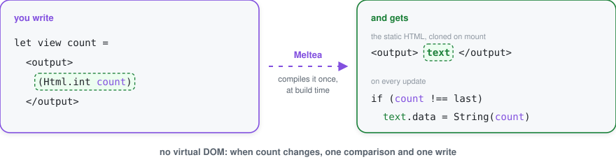
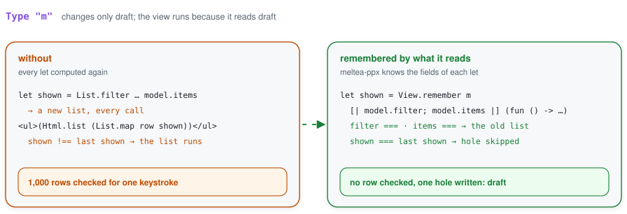
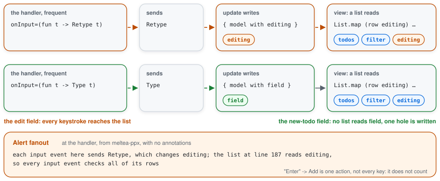
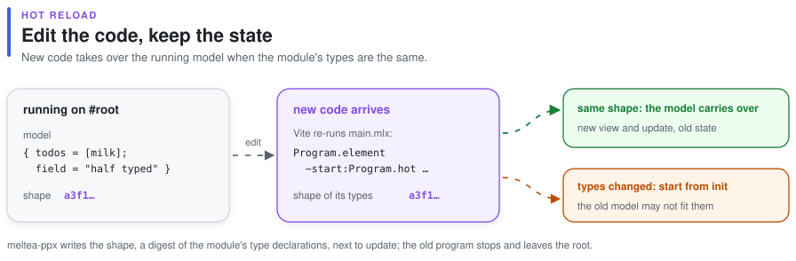
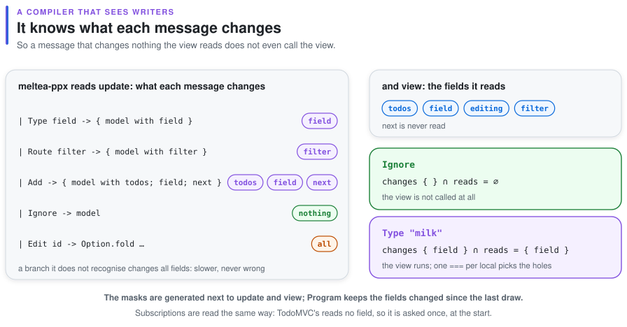
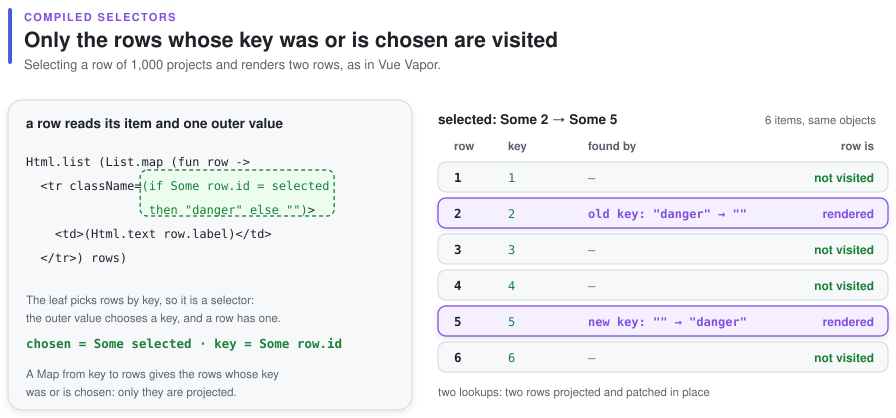

<div align="center">

<picture>
  <source media="(prefers-color-scheme: dark)" srcset="assets/meltea-dark.svg">
  
</picture>

# Meltea

**The Elm architecture for OCaml and Melange: pure functions everywhere, views in mlx,
compiled like Svelte.**

</div>

A model, messages, a pure `update`, a pure `view`. No hooks, no components with state, no
virtual DOM. The view is written in mlx and compiled at build time into a DOM template with
holes and a refresh function that writes only what changed.

```ocaml
type message = Increment | Decrement | Reset

let update message count =
  match message with Increment -> count + 1 | Decrement -> count - 1 | Reset -> 0

let view count =
  <div className="counter">
    <button onClick=Decrement>(Html.text "-")</button>
    <output>(Html.int count)</output>
    <button onClick=Increment>(Html.text "+")</button>
    <button onClick=Reset disabled=(count = 0)>(Html.text "reset")</button>
  </div>

let () = Option.iter (fun root -> ignore (Program.sandbox ~init:0 ~update ~view root)) root
```

<picture>
  <source media="(prefers-color-scheme: dark)" srcset="assets/compiled-dark.svg">
  
</picture>

## How it works

- **Templates.** `meltea-ppx` turns the static part of every view into HTML, parsed once into a
  `<template>` and cloned. Every dynamic part is a hole, reached on the clone by a
  `firstChild`/`nextSibling` walk the compiler writes out.
- **Refresh.** For every template the compiler emits the update code, as Svelte and
  [dartea](https://github.com/jongleb/dartea) do. Each local the view reads is checked with one
  `===`; only the holes that read a changed one are evaluated and written. Pure views and
  immutable values make this exact: an unchanged reference is an unchanged value.
- **Fields.** The compiler reads `update` and `view`: which model fields each message can change,
  which fields the view reads. A message that changes nothing the view reads does not call it, and
  `subscriptions` are asked again only when a field they read changed.
- **Remembered values.** `let shown = List.filter … model.items` at the top of a view is computed
  again only when `model.items` or another input changed; otherwise it is the same list, and the
  holes that read it are skipped, so typing in a field does not check the list's rows.

  <picture>
    <source media="(prefers-color-scheme: dark)" srcset="assets/remember-dark.svg">
    
  </picture>
- **Fanout.** The compiler follows each frequent event (typing, keys, pointer moves, scroll) to the
  message it sends, the fields that message's branch writes and the lists that read them. When
  typing in a field would make a list check all its rows on every keystroke, it says so at the
  handler, as a compiler alert.

  <picture>
    <source media="(prefers-color-scheme: dark)" srcset="assets/fanout-dark.svg">
    
  </picture>
- **Lists.** `Html.list (List.map row items)` is a keyed loop with selectors: a row is rendered
  again only when its item is another object or a piece of it that reads outer values changed.
- **Events.** `onClick=Increment` sends a message. `onInput` and `onKeyDown` take a function of
  the value or the key, `onCheck` of the checked state. Handlers are delegated to `document`.
- **Controlled inputs.** `value` and `checked` always show the model: after typing, the field
  gets the model's value back if the update did not take the input.
- **Pacing.** A message sent by a click or a key is drawn at the next microtask; messages sent by
  pointer moves, scroll and wheel are drawn once per frame, as the Elm runtime does, and a click
  in between draws at once.
- **Hot reload.** With `~start:Program.hot` and Vite's HMR, an edit to the code shows the new view
  of the old model; when the module's types changed it starts from `init`.

  <picture>
    <source media="(prefers-color-scheme: dark)" srcset="assets/hot-dark.svg">
    
  </picture>
- **Effects.** `Cmd` and `Sub` are values that describe effects; `Program` runs them.
- **Server.** `Program.render` writes HTML in React's format, `~start:Program.hydrate` takes it over
  in the browser; compile with `(pps melange.ppx meltea-ppx -hydratable)` to include the code that
  does it. On a server the same module builds against `meltea.server` with `meltea-ppx -server`:
  the view compiles to code that writes strings, with no DOM, natively or in Node.
  `Melhole_server.capture` in the page's head keeps the clicks and typing made before the code
  arrives, and hydration delivers them.
- **Transitions.** `Html.transition ~name` and `Html.transition_group ~name` animate what enters,
  leaves and moves with CSS classes, as Vue's `<Transition>` and `<TransitionGroup>`;
  `Cmd.view_transition` from an update draws inside the browser's View Transitions.

<picture>
  <source media="(prefers-color-scheme: dark)" srcset="assets/fields-dark.svg">
  
</picture>

<picture>
  <source media="(prefers-color-scheme: dark)" srcset="assets/selectors-dark.svg">
  
</picture>

The counter's view compiles to this JavaScript (names shortened):

```js
const template = View.template(Template.html("<div class=\"counter\"><button>-</button>…"),
  (scope, div) => {
    const minus = div.firstChild, output = minus.nextSibling, plus = output.nextSibling, …;
    return [handler_hole(scope, minus, "click"), text_hole({ parent: output, before: null }), …];
  });

const view = (count, dispatch) =>
  View.compiled(template, 2, (scope, holes) => {
    const sent = check(scope, 0, dispatch), counted = check(scope, 1, count); // one === each
    if (sent === Changed) set_handler(holes[0], () => dispatch(Decrement));  // first draw only
    if (counted === Changed) set_text(holes[1], String(count));
    …
  });
```

## Transitions

<picture>
  <source media="(prefers-color-scheme: dark)" srcset="assets/transition-dark.svg">
  
</picture>

```ocaml
let view model =
  <ul className="todo-list">
    (Html.transition_group ~name:"fade" (Html.list (List.map row (visible model))))
  </ul>
```

```css
.fade-enter-from, .fade-leave-to { opacity: 0; }
.fade-enter-active, .fade-leave-active, .fade-move { transition: all 200ms; }
```

The wrapper stays mounted while what it shows changes. An element that appears gets
`fade-enter-from` and `fade-enter-active`, then `fade-enter-to` from the next frame; one that goes
stays where it was with the `leave` classes until its transition ends. The time is `~duration`
milliseconds, or the longest delay plus duration in the element's computed style. The first render
does not animate.

## TodoMVC

[`examples/todomvc`](examples/todomvc/todomvc.mlx) is the full [TodoMVC](https://todomvc.com):
routing by `#/active` and `#/completed`, editing with Enter, Escape and blur, `localStorage`
through [jsonkit](https://github.com/melange-community/jsonkit)'s `[@@deriving json]`. A row:

```ocaml
let row editing todo =
  let text = match editing with Editing { id; text } when id = todo.id -> Some text | _ -> None in
  <li key=(string_of_int todo.id) className=(...)>
    <div className="view">
      <input className="toggle" type_="checkbox" checked=(todo.status = Completed)
        onCheck=(fun _ -> Toggle todo.id) />
      <label onDoubleClick=(Edit todo.id)>(Html.text todo.title)</label>
      <button className="destroy" onClick=(Destroy todo.id) />
    </div>
    (Option.fold ~none:Html.none ~some:(fun text -> <input className="edit" value=text ... />) text)
  </li>
```

The update asks for focus with `Cmd.focus`, `main.mlx` saves through `Cmd.port`, and the route
comes from `Sub.hash`. A model-based law drives it with real DOM events (typing, Enter, Escape,
double-click, blur, clicks, hash changes) and checks the page against a plain list of todos
after every step.

## On a server

<picture>
  <source media="(prefers-color-scheme: dark)" srcset="assets/served-dark.svg">
  
</picture>

One module with the model, `update` and `view` builds for both sides
([`examples/served`](../examples/served)):

```
(executable                              ; the server, native
 (name server)
 (libraries meltea.server)
 (preprocess (pps meltea-ppx -server)))

(melange.emit                            ; the browser
 (target app)
 (libraries meltea)
 (preprocess (pps melange.ppx meltea-ppx -hydratable)))
```

```ocaml
(* server: the capture script, the model as data, the page *)
"<script>" ^ Melhole_server.capture ^ "</script>" ^ Melhole_server.data ~id:"model" (encode model)
^ "<div id=\"root\">" ^ Program.render ~view:Page.view model ^ "</div>"

(* browser: start from the server's model, no init and no commands run twice *)
Option.iter
  (fun text -> ignore (Program.sandbox ~start:Program.hydrate ~init:(decode text) ~update:Page.update ~view:Page.view root))
  (Melhole.Served.data ~id:"model")
```

## API

| module | what it gives |
|---|---|
| `Program` | `sandbox ~init ~update ~view root`, `element ~init ~update ~view ~subscriptions root`, `dispatch`, `flush`, `stop`; `render ~view model` for the server and `~start:Program.hydrate` to take its HTML over |
| `Html` | `text`, `int`, `float`, `none`, `list`, `keyed`, `map`, `memo` (Elm's `lazy`), `transition` and `transition_group` (`~name`, `?duration`) |
| `Cmd` | `none`, `batch`, `map`, `message`, `perform` (a promise), `focus` (an element by id, after the next draw), `port` (a value out to JavaScript), `view_transition` (the next draw inside `document.startViewTransition`) |
| `Sub` | `none`, `batch`, `map`, `every`, `hash` (the URL fragment) |

Attributes are the familiar DOM props (`className`, `value`, `checked`, `disabled`, …) with
their OCaml types; a typo is a compile error that names the element.

## Use

```
(melange.emit
 (target app)
 (libraries meltea)
 (preprocess (pps melange.ppx meltea-ppx)))
```

and `(dialect (name mlx) …)` in `dune-project` for `.mlx` files. Until the opam release, pin it:
`opam pin add melhole meltea meltea-ppx https://github.com/jongleb/meltea.git`.

## Tested by laws

Property-based tests, not scenarios:

- after any sequence of messages, the DOM is the view of `fold update init messages`;
- a message that keeps the model, or a flush with nothing pending, writes nothing;
- a hole is evaluated once on mount and again exactly when a local it reads changes;
- `Html.memo` and `Html.map` behave as in Elm;
- after any change of subscriptions, a hash change sends exactly the current ones' messages;
- TodoMVC shows the todos, the count and the route after any user actions;
- keyed loops reuse a row exactly when its item and projection are unchanged, and patching always
  shows what mounting from scratch shows, under random edits (swaps, moves, inserts, clears);
- the shared template compiler and the keyed list algorithm have their own laws, 24 of them
  checked 2,000 times each.

```console
$ dune build && dune test && dune build @runtest-js && npx vitest run
```

## Where it is developed

Meltea shares its runtime and compiler, `melhole`, with [Melact](https://github.com/jongleb/melact),
the reason-react-compatible sibling for code that already lives on React. Both are developed in
that repository; this one is a mirror of Meltea's part, exported by `scripts/publish-meltea.sh`.
Issues and ideas are welcome here.
